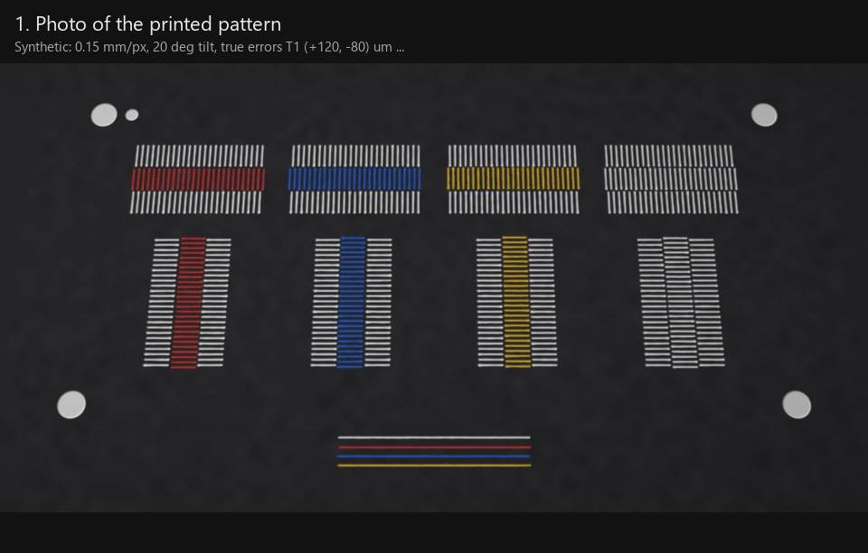
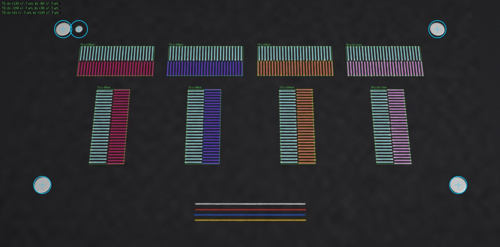
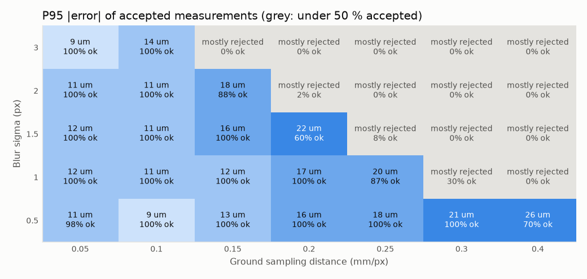
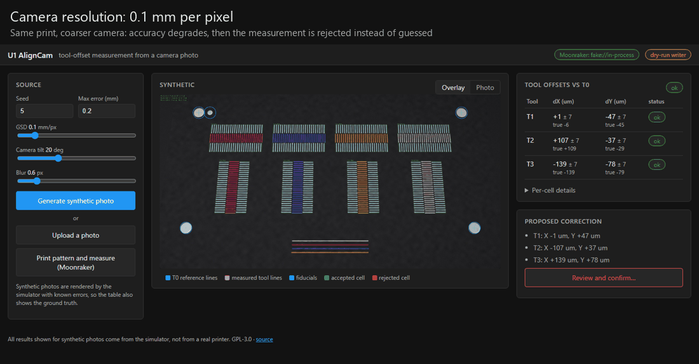
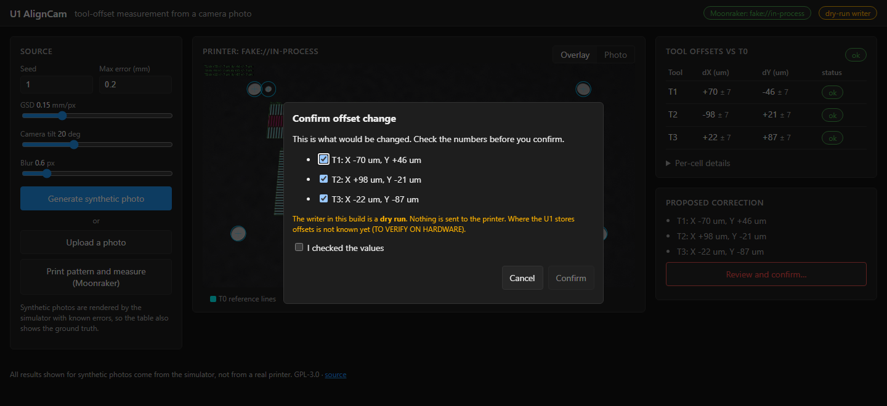

# U1 AlignCam

[](https://github.com/antonio94770/u1-aligncam/actions/workflows/ci.yml)
[](LICENSE)


**Camera-based measurement of the XY offsets between the four tool heads of the
Snapmaker U1.** Every tool prints a small vernier/grating pattern. The chamber
camera photographs it, and computer vision estimates where each tool actually
printed relative to T0. The tool then *proposes* a correction. It never writes one
by itself.

> **Status: pre-hardware prototype.** All results in this repository come from
> **synthetic images** with known ground truth. Nothing has been tested on a real
> U1 yet. Every hardware assumption is marked `TO VERIFY ON HARDWARE` and listed in
> [docs/hardware-todo.md](docs/hardware-todo.md).



**Highlights**

- A **T0 | Tn | T0 vernier sandwich**, printed in one layer, that cancels lens
  distortion and camera pose errors to first order.
- **Sub-pixel phase fit**, cross-checked by an independent line-by-line vernier
  reading and an edge-based coarse position.
- **Rejects instead of guessing**: thirteen reason codes, an uncertainty for every
  number, and a T0-vs-T0 control cell.
- A **realistic simulator and a 4770-image benchmark** that answers "which camera
  is good enough?", and that found three real design flaws before any hardware
  existed.
- **Safe by design**: the only offset writer is a dry run, and its confirmation is
  bound to the exact proposal the user reviewed.

**Contents:** [Problem](#the-problem) · [Approach](#approach-short) ·
[Results](#benchmark-results-synthetic-data-only) · [Demo](#web-demo-and-printer-integration-mock) ·
[Quick start](#quick-start) · [Limitations](#known-limitations) ·
[Why real hardware is needed](#why-real-hardware-is-needed) · [Roadmap](#roadmap)

## The problem

Multi-colour prints on a toolchanger need every tool to print in exactly the same
place. Snapmaker specifies a tool-to-tool alignment better than 0.04 mm, obtained
with a calibration sensor. Colour misalignment is still common enough to have its
own troubleshooting page in the Snapmaker wiki. AlignCam aims to give users an
independent check of the result **on the actual print**, using only the camera
that is already in the chamber.

## Approach (short)

1. **Pattern.** For each tool and axis, T0 | Tn | T0 print three gratings side by
   side (1.20 / 1.14 mm pitch, a vernier). The symmetric sandwich cancels lens
   distortion and homography errors to first order. Four T0 disks act as
   fiducials. A T0-vs-T0 control cell measures the bias of the method itself.
2. **Measurement.** Fiducials → homography → rectified gratings → colour-agnostic
   line signal → least-squares **phase fit** (sub-pixel), checked against an
   independent **line-by-line vernier reading**.
3. **Safety.** Every result carries an uncertainty. A measurement that fails a
   quality gate is **rejected** with a reason code instead of returning a number.

Details and the reasons behind the design choices: [docs/method.md](docs/method.md).
Related projects (kTAMV, TAMV, duet-tool-align, Bambu H2D): [docs/prior-art.md](docs/prior-art.md).


*Synthetic image (simulated camera, 0.15 mm/px, 20° tilt) with the detection overlay:
fiducials (cyan circles), detected line centres of the T0 | Tn | T0 cells, per-cell
offsets. True errors were T1 (+120, -80), T2 (-200, +50), T3 (+40, +150) um.*

## Benchmark results (synthetic data only)

4770 synthetic photos and 28 620 tool-axis measurements, with random true errors
of +/-0.3 mm and randomised print, lighting, camera and compression
imperfections. Full tables and every plot:
[docs/benchmark.md](docs/benchmark.md). Reproduce with
`aligncam bench && aligncam bench-report` (about 15 minutes on 16 cores).

**The question: with which camera does this reach 0.02-0.04 mm?**

On synthetic data, the measurement holds a 95th-percentile error of about
**13 um** down to a ground sampling distance of **0.15 mm per pixel** on the bed
(blur up to 1.5 px, at least 90 % of measurements accepted). Above about
0.25 mm/px the lines are no longer resolved. The method then **rejects** instead
of guessing: at 0.4 mm/px, 84 % of measurements are rejected and accepted errors
stay within about 20 um.



What 0.15 mm/px means in hardware terms (camera looking straight down at the
pattern; tilted views need more resolution):

| Resolution | HFOV 60 deg | HFOV 80 deg | HFOV 100 deg | HFOV 120 deg |
|---|---:|---:|---:|---:|
| 1280 x 720 | 166 mm | 114 mm | 81 mm | 55 mm |
| 1920 x 1080 | 249 mm | 172 mm | 121 mm | 83 mm |
| 2592 x 1944 (5 MP) | 337 mm | 232 mm | 163 mm | 112 mm |
| 3840 x 2160 (4K) | 499 mm | 343 mm | 242 mm | 166 mm |

*Maximum camera-to-pattern distance for 0.15 mm/px.* Public sources give the U1
camera as 1080p, mounted on the right inner side panel; its lens and exact pose are
not published. Simulating that side camera over a range of plausible poses
([docs/u1-camera.md](docs/u1-camera.md), synthetic): at the bed centre at most 20 %
of measurements pass. With the pattern rotated 90 deg, 70 mm from the camera-side
edge ([config/placements/u1-side.yaml](config/placements/u1-side.yaml)) and a
calibrated lens, 53 % pass (71-75 % if the camera sits 100 mm or more above the
bed), P95 16 um, none accepted with an error above 40 um. Without lens calibration
it drops to 17 %, so on the U1 calibration is required. If it turns out too coarse, the
plan-B nozzle camera ([docs/plan-b-nozzle-camera.md](docs/plan-b-nozzle-camera.md))
avoids the problem.

| Factor (others random) | Holds the target up to | Then |
|---|---|---|
| Ground sampling distance | 0.25 mm/px (P95 18 um, 92 % accepted) | rejected |
| Blur | 2 px sigma (P95 18 um) | rejected |
| Camera tilt | 55 deg (P95 19 um); 65 deg with a quarter rejected | rejected |
| Uncorrected lens distortion | k1 = -0.1 (typical webcam); -0.2 with half rejected | rejected; calibrate the camera |
| Sensor noise | the whole tested range (up to 5 % of full scale) | - |
| Filament/plate contrast | 0.35 of nominal (1.4 % unsafe at 0.35) | rejected |
| Directional lighting | 0.3 (P95 18 um); 0.5: P95 27 um, 0.6 % unsafe | **main open risk** |

Across all 28 620 measurements, including the deliberately hostile sweeps, the
rate of *accepted but wrong* results (|error| > 40 um) is **0.06 %**. Under
nominal conditions, 2-sigma coverage of the reported uncertainty is 95-98 %.

### What the benchmark taught (and changed in the design)

- **Lens distortion** broke the first two-grating layout: errors of tenths of a
  millimetre. The fix was the **T0 | Tn | T0 sandwich**, which cancels smooth error
  fields to first order.
- **Wrong period.** A centroid-based coarse position, biased by uneven light, once
  let errors of about 0.6 mm (half a pitch) through, with phase and vernier
  agreeing. It was replaced by an edge-based check that **rejects** instead.
- **Oblique views** (a camera on a side panel) make near fiducials several times
  larger than far ones. The fiducial search used to reject such images outright;
  with a perspective-tolerant search, tilts of 55 deg are fully accepted.
- **Filaments lighter and darker than the plate**, under directional light, shift
  in opposite directions. This bias is invisible to every internal check. It is now
  rejected (`polarity_mismatch`, `shading_sensitive`). On a gold-coloured plate
  with random filaments, this means only 8 % of measurements pass, while 0.5 % are
  still wrong. The practical advice: calibrate with filaments that contrast
  strongly with the plate and are all on the same side of it (all lighter or all
  darker).

## Known limitations

- **Synthetic only.** The simulator is a model. Real prints have effects it does
  not include (elephant foot, nozzle wipe marks, specular plate texture, JPEG
  artefacts of the actual webcam firmware, warping).
- **Lighting bias.** Directional light shifts the apparent centre of a raised
  bead by an amount that depends on the filament colour. The gates catch the
  worst cases, but how directional the U1 chamber light is decides the real
  accuracy.
- **It measures the material, not the nozzle.** Extrusion asymmetries that differ
  between tools show up as offset. That is useful for the user, but it is not the
  same as the firmware offset.
- **XY only**, offsets up to +/-0.5 mm (unambiguous range), single layer on a
  flat plate.
- The correction sign convention and the place where U1 stores offsets are
  unknown. Writing is an abstract interface and is never automatic.

## Why real hardware is needed

1. **Real precision on real prints.** First-layer quality, bead shape, ooze and
   colour of real filaments on the real plate decide the noise floor. The
   T0-vs-T0 control cell will measure the true systematic floor of the method.
2. **Camera position and quality.** Resolution, field of view, distance, tilt,
   focus, compression and exposure of the U1 chamber camera are unknown. They
   decide whether the pattern is resolved (GSD <= ~0.15-0.25 mm/px) or whether the
   plan-B microscope is needed.
3. **Lighting.** The benchmark identifies directional lighting as the main
   source of accepted bias. Only the real chamber can tell how strong it is.
4. **Safe offset writing.** Where the U1 keeps tool offsets, how its macros
   apply them, and their sign convention must be read from the real firmware
   before any write path exists. Until then, AlignCam only proposes a correction
   and the user confirms it.
5. **Validation against the built-in calibration.** Comparing AlignCam with the
   U1 calibration sensor, and with prints measured under a microscope, is the only
   way to turn synthetic numbers into real ones.

## Quick start

```bash
python -m venv .venv
.venv/Scripts/activate          # Windows; source .venv/bin/activate elsewhere
pip install -e ".[dev]"

aligncam pattern --out out/pattern                       # G-code + SVG preview
aligncam simulate --out out/sim --random-offsets-mm 0.2  # synthetic photo + ground truth
aligncam measure out/sim.png --truth out/sim.json --out out/meas
aligncam bench --cases 60 && aligncam bench-report       # full benchmark (~15 min)

aligncam serve --fake                                    # web demo on http://127.0.0.1:8080
```

## Web demo and printer integration (mock)


*The same synthetic print seen by a camera at 0.1, 0.2, 0.3 and 0.4 mm per pixel.
At 0.4 mm/px two tools are rejected (`low_snr`) instead of being given a wrong
number.*

`aligncam serve --fake` starts a small Fluidd-style page. It can:

- render a **synthetic photo** with random tool errors (resolution, tilt and blur
  sliders) and show the measurement next to the ground truth;
- measure an **uploaded photo**;
- run the full **printer workflow** against a Moonraker: upload the pattern
  G-code, start the print, wait, take a webcam snapshot, measure, propose a
  correction. With `--fake`, an in-process fake Moonraker plays the printer. It has
  hidden tool errors and returns a synthetic photo of the printed pattern.
  `aligncam serve --moonraker http://<printer>:7125` points it at a real Moonraker
  (untested on a U1: TO VERIFY ON HARDWARE).

**Offsets are never written automatically.** The page shows the proposed
correction. Applying it opens a confirmation dialog: the user picks the tools and
ticks "I checked the values". The confirmation is bound to that exact proposal
(by digest). The only writer in this build is a **dry run**, which reports what it
would change and sends nothing to the printer. The Moonraker client has no method
that changes offsets, and the tests check that the workflow never sends a G-code
command.

Only standard Moonraker endpoints are used: `/server/files/upload`,
`/printer/print/start`, `/printer/objects/query`, `/server/webcams/list`, and the
webcam snapshot URL.


*After "Print pattern and measure" on the fake printer: the proposed correction
must be reviewed and confirmed explicitly, and the writer is a dry run.*

## Command reference

| Command | What it does |
|---|---|
| `aligncam pattern` | G-code of the calibration pattern + SVG preview |
| `aligncam simulate` | synthetic photo + JSON ground truth |
| `aligncam measure IMAGE` | offsets, uncertainty, reasons; `--out` also writes the overlay |
| `aligncam bench` / `bench-report` | Monte Carlo benchmark, plots and `docs/benchmark.md` |
| `aligncam serve [--fake \| --moonraker URL]` | web demo |
| `aligncam fake-moonraker` | standalone fake Moonraker on port 7125 |
| `python tools/make_media.py` | regenerates the GIFs and screenshots in this README |

## Configuration

Hardware-dependent settings live in [`config/`](config). Every unknown is marked
`TO VERIFY ON HARDWARE`. Pass any combination with `-c`, later files win:

```bash
aligncam pattern -c config/pattern.default.yaml -c config/printer.u1.template.yaml
```

- [`pattern.default.yaml`](config/pattern.default.yaml): pattern geometry and
  measurement gates.
- [`printer.u1.template.yaml`](config/printer.u1.template.yaml): bed, filaments,
  speeds, and the **Jinja2 templates** for the start, tool-change and end G-code.
  The real U1 macros go here once known.
- [`camera.u1.template.yaml`](config/camera.u1.template.yaml): snapshot URL and an
  optional OpenCV camera calibration.

## Development

```bash
pip install -e ".[dev]"
ruff check . && ruff format --check .
pytest                      # ~1 minute; the full benchmark is not part of CI
```

CI runs lint and tests on Linux and Windows, Python 3.11-3.13. Contributor and
coding-agent guidelines (no invented U1 details, no automatic offset writes,
synthetic results only): [AGENTS.md](AGENTS.md).

## Repository layout

```
config/          YAML configs (pattern, printer template, camera template)
src/aligncam/    geometry, pattern (G-code), sim (synthetic camera), measure, bench,
                 printer (Moonraker client, fake Moonraker, offsets), web, cli
tests/           pytest suite, run in CI on Linux and Windows
docs/            method, benchmark, prior art, hardware TODO list, plan B
tools/           make_media.py (README GIFs and screenshots)
```

## Roadmap

**Done, without hardware**

- [x] M1: vernier pattern, G-code generator with configurable macro templates, image simulator
- [x] M2: measurement pipeline with uncertainty and rejection, tests
- [x] M3: Monte Carlo benchmark (resolution, blur, noise, contrast, tilt, distortion, lighting), plots
- [x] M4: Moonraker client + fake Moonraker, dry-run offset writer with bound confirmation, web demo
- [x] M5: documentation, demo GIFs and screenshots
- [x] Plan B design: upward-looking nozzle camera, kTAMV-style ([docs](docs/plan-b-nozzle-camera.md))

**Next, with a U1**

1. Read the real configuration: tool-change macros, offset storage and sign,
   camera stream, bed size. Replace every `TO VERIFY ON HARDWARE` placeholder
   ([list](docs/hardware-todo.md)).
2. Print the pattern with all four tools. Photograph it with the chamber camera
   and with a reference microscope or flatbed scan as ground truth.
3. Measure the real noise floor (control cell, repeated prints) and the lighting
   bias. Re-calibrate the gates and the systematic floor, and publish real results
   next to the synthetic ones, clearly labelled.
4. Compare against the U1 built-in calibration on purposely misaligned offsets.
5. Only then: a real `OffsetWriter` behind the same confirmation step, and a
   Fluidd/Mainsail panel or Moonraker component so users can run it from the
   printer UI.
6. If the chamber camera is not good enough: implement plan B (nozzle camera).
7. Lighting-bias calibration cell (same tool on a base of a different colour,
   known zero offset).

## License

GPL-3.0-or-later, see [LICENSE](LICENSE).
