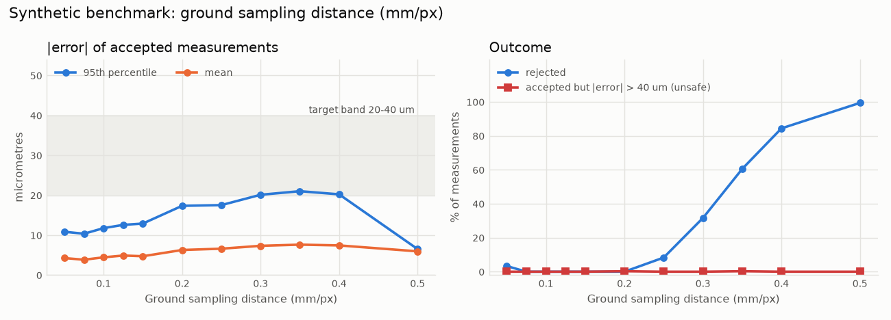
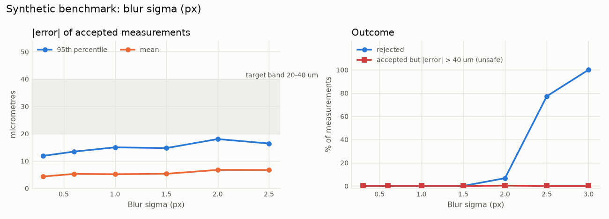
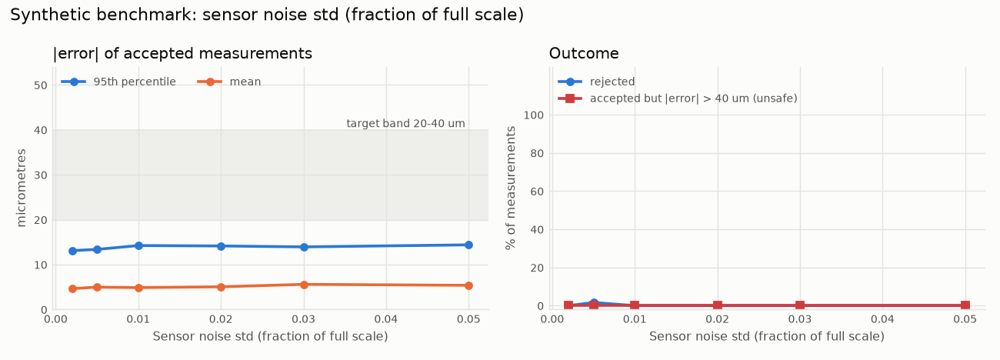
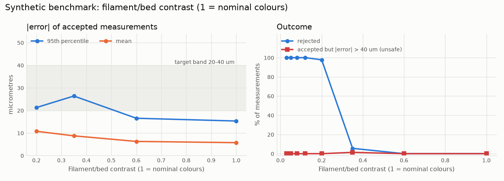
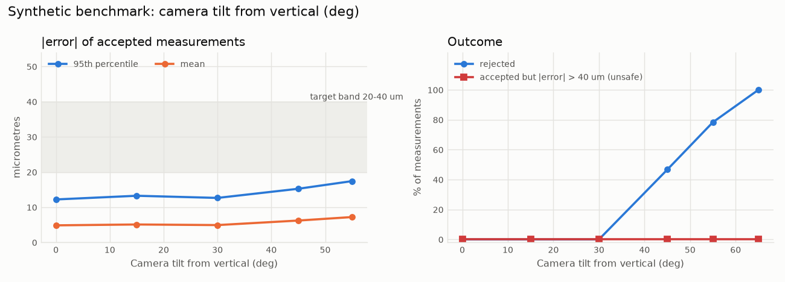
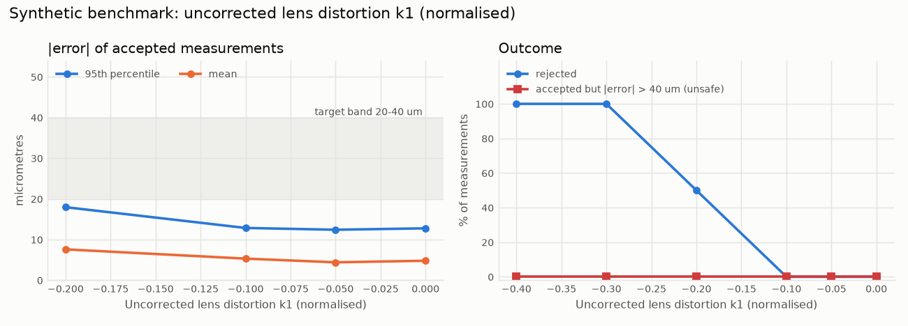
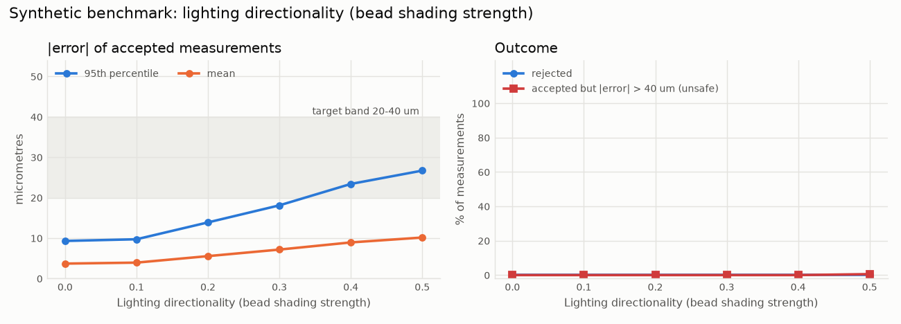

# Benchmark (synthetic data only)

> Every number on this page comes from **synthetic images** rendered by
> `aligncam.sim` with known ground truth. None of it has been measured on a
> real Snapmaker U1. Real prints and real cameras will be worse in ways the
> simulator does not model. See the README section *Why real hardware is needed*.

- Images: **4290**, tool-axis measurements: **25740**
- Each measurement: one tool (T1-T3), one axis, random true error in +/-0.3 mm.
- Unless swept, every case draws random nuisance parameters: camera tilt 0-35 deg,
  uncorrected distortion k1 in [-0.15, 0], blur 0.5-1.2 px, sensor noise, JPEG
  quality 70-95, uneven light and vignetting, plate texture, per-line placement
  jitter and wobble (5-20 um), bead-width jitter, start blobs, over/under
  extrusion per tool (+/-15 %), directional bead shading (0-0.3).
- **Unsafe** = accepted, but |error| > 40 um. This is the
  failure mode that matters: a rejected measurement costs a reprint, an unsafe
  one would mislead the user.

## Headline: which camera is good enough?

The grid below crosses ground sampling distance (mm per pixel on the bed) with
blur. The model is a GSD limit: the largest GSD at which, for every blur up to
1.5 px, at least 90 % of measurements are accepted and the 95th-percentile
error of accepted ones stays within the limit.

- P95 <= 40 um: GSD up to **0.15 mm/px**
- P95 <= 20 um: GSD up to **0.15 mm/px**

Maximum camera-to-pattern distance for GSD <= 0.15 mm/px (pinhole model,
pattern near the optical axis, looking straight down. Tilted views and the
image corners have a coarser GSD, so treat these as upper bounds):

| Resolution | HFOV 60 deg | HFOV 80 deg | HFOV 100 deg | HFOV 120 deg |
|---|---:|---:|---:|---:|
| 1280 x 720 | 166 mm | 114 mm | 81 mm | 55 mm |
| 1920 x 1080 | 249 mm | 172 mm | 121 mm | 83 mm |
| 2592 x 1944 (5 MP) | 337 mm | 232 mm | 163 mm | 112 mm |
| 3840 x 2160 (4K) | 499 mm | 343 mm | 242 mm | 166 mm |

## Ground sampling distance (mm/px)

| Ground sampling distance | n | accepted | mean abs err (um) | P95 abs err (um) | unsafe | 2-sigma coverage |
|---:|---:|---:|---:|---:|---:|---:|
| 0.05 | 360 | 96.7 % | 4.3 | 10.9 | 0.0 % | 98.3 % |
| 0.075 | 360 | 100.0 % | 3.8 | 10.4 | 0.0 % | 98.3 % |
| 0.1 | 360 | 100.0 % | 4.4 | 11.8 | 0.0 % | 97.8 % |
| 0.125 | 360 | 100.0 % | 4.9 | 12.6 | 0.0 % | 97.2 % |
| 0.15 | 360 | 100.0 % | 4.7 | 12.9 | 0.0 % | 97.2 % |
| 0.2 | 360 | 100.0 % | 6.3 | 17.3 | 0.3 % | 91.7 % |
| 0.25 | 360 | 91.7 % | 6.6 | 17.5 | 0.0 % | 94.8 % |
| 0.3 | 360 | 68.3 % | 7.3 | 20.1 | 0.0 % | 91.1 % |
| 0.35 | 360 | 39.4 % | 7.6 | 21.0 | 0.3 % | 94.4 % |
| 0.4 | 360 | 15.6 % | 7.4 | 20.2 | 0.0 % | 98.2 % |
| 0.5 | 360 | 0.6 % | 5.9 | 6.5 | 0.0 % | 100.0 % |

## Blur sigma (px)

| Blur sigma | n | accepted | mean abs err (um) | P95 abs err (um) | unsafe | 2-sigma coverage |
|---:|---:|---:|---:|---:|---:|---:|
| 0.3 | 360 | 100.0 % | 4.3 | 11.9 | 0.0 % | 98.3 % |
| 0.6 | 360 | 100.0 % | 5.3 | 13.4 | 0.0 % | 97.2 % |
| 1 | 360 | 100.0 % | 5.1 | 15.0 | 0.0 % | 95.8 % |
| 1.5 | 360 | 100.0 % | 5.3 | 14.7 | 0.0 % | 95.8 % |
| 2 | 360 | 93.3 % | 6.7 | 18.0 | 0.3 % | 95.8 % |
| 2.5 | 360 | 22.8 % | 6.7 | 16.4 | 0.0 % | 98.8 % |
| 3 | 360 | 0.0 % | - | - | 0.0 % | - |

## Sensor noise std (fraction of full scale)

| Sensor noise std | n | accepted | mean abs err (um) | P95 abs err (um) | unsafe | 2-sigma coverage |
|---:|---:|---:|---:|---:|---:|---:|
| 0.002 | 360 | 100.0 % | 4.6 | 13.1 | 0.0 % | 98.1 % |
| 0.005 | 360 | 98.3 % | 5.0 | 13.4 | 0.0 % | 96.0 % |
| 0.01 | 360 | 100.0 % | 4.9 | 14.2 | 0.0 % | 96.9 % |
| 0.02 | 360 | 100.0 % | 5.1 | 14.1 | 0.0 % | 96.4 % |
| 0.03 | 360 | 100.0 % | 5.6 | 13.9 | 0.0 % | 96.1 % |
| 0.05 | 360 | 100.0 % | 5.4 | 14.4 | 0.0 % | 96.1 % |

## Filament/bed contrast (1 = nominal colours)

| Filament/bed contrast | n | accepted | mean abs err (um) | P95 abs err (um) | unsafe | 2-sigma coverage |
|---:|---:|---:|---:|---:|---:|---:|
| 0.03 | 360 | 0.0 % | - | - | 0.0 % | - |
| 0.05 | 360 | 0.0 % | - | - | 0.0 % | - |
| 0.08 | 360 | 0.0 % | - | - | 0.0 % | - |
| 0.12 | 360 | 0.0 % | - | - | 0.0 % | - |
| 0.2 | 360 | 2.2 % | 10.8 | 21.3 | 0.0 % | 87.5 % |
| 0.35 | 360 | 94.4 % | 8.8 | 26.4 | 1.4 % | 82.4 % |
| 0.6 | 360 | 100.0 % | 6.3 | 16.5 | 0.0 % | 92.5 % |
| 1 | 360 | 100.0 % | 5.7 | 15.3 | 0.0 % | 94.7 % |

## Camera tilt from vertical (deg)

| Camera tilt from vertical | n | accepted | mean abs err (um) | P95 abs err (um) | unsafe | 2-sigma coverage |
|---:|---:|---:|---:|---:|---:|---:|
| 0 | 360 | 100.0 % | 4.9 | 12.2 | 0.0 % | 97.2 % |
| 15 | 360 | 100.0 % | 5.1 | 13.3 | 0.0 % | 96.4 % |
| 30 | 360 | 100.0 % | 4.9 | 12.6 | 0.0 % | 97.2 % |
| 45 | 360 | 53.3 % | 6.2 | 15.3 | 0.0 % | 94.8 % |
| 55 | 360 | 21.7 % | 7.2 | 17.4 | 0.0 % | 93.6 % |
| 65 | 360 | 0.0 % | - | - | 0.0 % | - |

## Uncorrected lens distortion k1 (normalised)

| Uncorrected lens distortion k1 | n | accepted | mean abs err (um) | P95 abs err (um) | unsafe | 2-sigma coverage |
|---:|---:|---:|---:|---:|---:|---:|
| -0.4 | 360 | 0.0 % | - | - | 0.0 % | - |
| -0.3 | 360 | 0.0 % | - | - | 0.0 % | - |
| -0.2 | 360 | 50.0 % | 7.6 | 18.0 | 0.0 % | 91.7 % |
| -0.1 | 360 | 100.0 % | 5.3 | 12.9 | 0.0 % | 96.4 % |
| -0.05 | 360 | 100.0 % | 4.4 | 12.4 | 0.0 % | 97.2 % |
| 0 | 360 | 100.0 % | 4.8 | 12.8 | 0.0 % | 96.4 % |

## Lighting directionality (bead shading strength)

| Lighting directionality | n | accepted | mean abs err (um) | P95 abs err (um) | unsafe | 2-sigma coverage |
|---:|---:|---:|---:|---:|---:|---:|
| 0 | 360 | 100.0 % | 3.7 | 9.3 | 0.0 % | 99.7 % |
| 0.1 | 360 | 100.0 % | 3.9 | 9.7 | 0.0 % | 99.7 % |
| 0.2 | 360 | 100.0 % | 5.5 | 13.9 | 0.0 % | 95.3 % |
| 0.3 | 360 | 100.0 % | 7.2 | 18.1 | 0.0 % | 89.7 % |
| 0.4 | 360 | 100.0 % | 8.9 | 23.4 | 0.0 % | 80.0 % |
| 0.5 | 360 | 100.0 % | 10.1 | 26.7 | 0.6 % | 73.1 % |

## Random filament colours on two plate types

Four distinct filaments out of white, black, grey, red, blue, yellow, green,
orange on a dark or a gold textured plate (the real U1 plate is TO VERIFY ON
HARDWARE).

| Plate | n | accepted | P95 abs err (um) | unsafe | most common rejection |
|---|---:|---:|---:|---:|---|
| dark_pei | 678 | 73.2 % | 14.5 | 0.0 % | polarity_mismatch |
| gold_pei | 762 | 5.8 % | 50.1 | 0.7 % | shading_sensitive |
